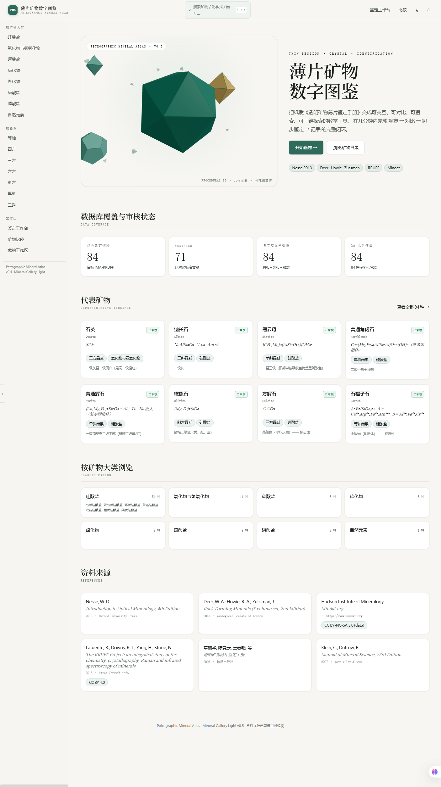
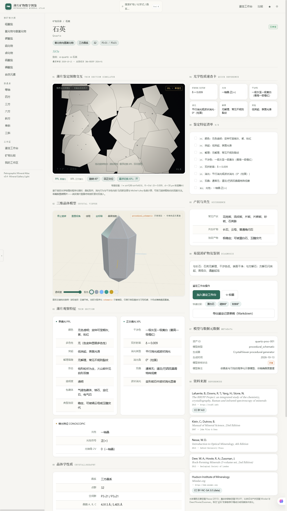

# 薄片矿物数字图鉴 · Petrographic Mineral Atlas

矿物晶体学数据库、三维晶体可视化与薄片鉴定辅助平台。

**当前版本：v0.5 · Mineral Gallery Light · 84 种矿物 + 薄片光学模拟器 + 3D 旋转多面体 Hero**





---

## 功能亮点

### 1. 薄片鉴定图像交互（核心功能）

**基于真实光学物理的程序化模拟**（非真实显微照片，页面有明确标注）：

- **Michel-Lévy 干涉色**：光程差 R = δ × 30μm（标准薄片厚度）→ 干涉色 RGB，
  锚点表覆盖一级灰白 → 二级鲜艳 → 高级白完整色序（`src/lib/interferenceColor.ts`）
- **正交偏光旋转模拟**：晶粒亮度 I ∝ sin²(2θ)·sin²(πR/λ)，
  转到消光位（0°/90°/180°/270°）晶粒全黑 —— 与真实显微镜行为一致
- **单偏光多色性**：多色性矿物（黑云母、角闪石、电气石、蓝闪石等）旋转时
  颜色在两个极端色间摆动
- **微观结构**：双晶条纹（XPL 下两半相位差 45°）、解理纹、包裹体、晶界
- **交互**：拖动旋转物台（0–360°）、滚轮缩放、悬浮 PPL↔XPL、双击重置、
  键盘 ←→ 旋转 / P 切模式、45° 步进按钮
- **不透明矿物**：显示为透射光下全黑（科学正确），如磁铁矿、黄铁矿

### 2. 多主题系统

- **全局主题**（顶栏切换，persist localStorage）：浅色 Mineral Gallery Light（默认）/
  深色 Deep Crystal / 高对比（投影与弱视友好）
- **页面级氛围**（随路由微调）：矿物详情聚焦、鉴定工作台实验台、比较/收藏中性数据
- 实现方式：CSS Variables + `data-theme` / `data-page` 属性，
  Tailwind 色板全部映射到变量（`tailwind.config.ts`）

### 3. 文本可读性（WCAG AA）

- 浅色主题主文字 `#1A1F1C`、次文字 `#4A554E`、弱文字 `#7A857C`（全部 ≥ WCAG AA）
- 正文 15px / 行高 1.7，数据表格 13px
- 标题 Noto Serif SC，正文 Inter + Noto Sans SC

### 4. 3D 旋转多面体 Hero（v0.5）

- React Three Fiber 程序化多面体群：二十面体 + 八面体 + 十二面体 + 悬浮碎片
- 自动旋转 + 鼠标拖拽，随主题切换配色，WebGL 不可用时回退 2D 几何插图

---

## 项目定位

面向地质学、矿物学、岩石学学生与研究人员，将矿物的薄片鉴定特征、晶体结构属性、理想三维形态、显微镜下的观察特征和可追溯的参考资料整合到统一平台。

产品目标：把纸质《透明矿物薄片鉴定手册》变成可交互、可对比、可搜索、可三维探索的数字工具，
让用户在几分钟内完成「观察 → 对比 → 初步鉴定 → 记录」的完整闭环。

- **系统 A**：矿物鉴定知识库（晶体学 + 光学属性 + 产状 + 来源）
- **系统 B**：三维晶体可视化实验室（React Three Fiber）
- **系统 C**：矿物检索与辅助鉴定（规则评分可解释）

## 当前数据库真实覆盖情况

| 类别 | 数量 | 说明 |
|---|---|---|
| 已收录矿物种 | **84** | 常见造岩矿物、副矿物与不透明矿物 |
| verified 状态 | 约 60 | 已对照标准文献与开放数据库 |
| provisional 状态 | 约 24 | 来源明确但细节需复核 |
| 具晶胞参数 | 部分 | 来自 RRUFF，标注适用条件 |
| 具完整 PPL 属性 | 84 | 来自 Nesse (2013) |
| 具完整 XPL 属性 | 84 | 来自 Nesse (2013) |
| 具锥光光性 | 84 | 不透明矿物标注"不透明" |
| 具 3D 模型（示意） | 84 | 全部为 `procedural_schematic` |
| 经验证模型（verified） | **0** | 暂未制作 Blender 精确晶形 |

**按结构分族的收录**：

| 族 | 文件 | 数量 |
|---|---|---|
| 架状硅酸盐（石英族、长石族、似长石） | `framework.ts` | 13 |
| 层状硅酸盐（云母族、绿泥石、蛇纹石等） | `sheet.ts` | 9 |
| 单链硅酸盐（辉石族） | `singleChain.ts` | 8 |
| 双链硅酸盐（角闪石族） | `doubleChain.ts` | 7 |
| 岛状硅酸盐（橄榄石、锆石、绿帘石、Al₂SiO₅ 三形等） | `island.ts` | 11 |
| 环状硅酸盐（电气石、绿柱石、堇青石） | `ring.ts` | 3 |
| 碳酸盐/硫酸盐/磷酸盐/卤化物 | `nonsilicates.ts` | 12 |
| 氧化物/硫化物/自然元素（含不透明矿物） | `opaques.ts` | 15 |
| 补充（方沸石、菱镁矿、铁闪石、水镁石、硬柱石） | `extras.ts` | 5 |

⚠ 这 84 种矿物是系统结构验证集，**不构成完整矿物名录**。
长期目标：以 IMA-RRUFF 名录为基础，分阶段扩充至全部目标矿物种。

## 视觉设计系统：Mineral Gallery Light（v0.5 默认）

浅色博物馆感主题，参考画廊排版：

- **背景**：米白 `#F7F6F2` + 白色卡片
- **强调**：祖母绿 `#2F6B5A`（主）/ 薄荷绿 `#5B9A8B`（辅）/ 琥珀金 `#C4A35A`（点缀）
- **文字**：`#1A1F1C` / `#4A554E` / `#7A857C`
- **质感**：1px 极细边框 + 三层阴影 + 14-16px 圆角 + 毛玻璃导航

深色 Deep Crystal 主题保留为 alternate（深空黑 + 冷月光蓝 + 祖母绿 + 琥珀金）。

## 技术栈

- **前端**：Next.js 14 (App Router) + TypeScript + Tailwind CSS + Framer Motion
- **3D**：Three.js + React Three Fiber + Drei
- **状态**：Zustand（收藏/最近查看/工作台，persist localStorage）
- **数据**：TypeScript 静态数据 + 来源标注（后续接入 FastAPI + PostgreSQL）
- **3D 资产**：Blender Python 自动化脚本（独立工具链）
- **测试**：Jest（18 个数据与评分测试）

## 目录结构

```
mineral-atlas/
├── src/
│   ├── app/                      # Next.js App Router 路由
│   │   ├── page.tsx              # 首页（英雄区动态晶体 + 覆盖率面板）
│   │   ├── minerals/
│   │   │   ├── page.tsx          # 矿物目录（搜索/筛选/排序/双视图）
│   │   │   └── [id]/page.tsx     # 矿物详情（双栏 + 3D + 速查卡 + 勾选清单）
│   │   ├── identify/page.tsx     # 鉴定工作台（规则评分可解释）
│   │   ├── compare/page.tsx      # 矿物比较（1–6 种 + 差异高亮）
│   │   ├── favorites/page.tsx    # 我的工作区（收藏/最近/工作台）
│   │   ├── layout.tsx            # 顶栏 + 可折叠侧边栏
│   │   └── globals.css           # 深地晶体设计系统
│   ├── components/               # React 组件
│   │   ├── CrystalViewer.tsx     # 3D 查看器（6 配色/线框/透明度/晶面指数）
│   │   ├── CommandPalette.tsx    # 全局命令面板（Ctrl+K）
│   │   ├── TopNav.tsx            # 顶部导航
│   │   ├── Sidebar.tsx           # 左侧可折叠导航
│   │   ├── StatusBadge.tsx       # 数据状态徽章
│   │   └── BenchActions.tsx      # 特征清单 + 工作台操作 + Markdown 导出
│   ├── data/
│   │   ├── minerals/             # 按族拆分的 84 种矿物数据
│   │   │   ├── index.ts          # 汇总 + 分类树 + 属性-来源映射
│   │   │   ├── helper.ts         # M() 构造辅助
│   │   │   ├── framework.ts      # 架状硅酸盐（13）
│   │   │   ├── sheet.ts          # 层状硅酸盐（9）
│   │   │   ├── singleChain.ts    # 单链硅酸盐（8）
│   │   │   ├── doubleChain.ts    # 双链硅酸盐（7）
│   │   │   ├── island.ts         # 岛状硅酸盐（11）
│   │   │   ├── ring.ts           # 环状硅酸盐（3）
│   │   │   ├── nonsilicates.ts   # 碳酸盐/硫酸盐/磷酸盐/卤化物（12）
│   │   │   ├── opaques.ts        # 氧化物/硫化物/自然元素（15）
│   │   │   └── extras.ts         # 补充矿物（5）
│   │   └── references.ts         # 6 份标准文献元数据
│   ├── lib/
│   │   ├── mineralStore.ts       # 数据访问 + 鉴定评分引擎
│   │   ├── workspaceStore.ts     # Zustand 工作区状态
│   │   └── crystalGeometry.ts    # 84 种矿物几何映射 + 晶面标注
│   └── types/mineral.ts          # 数据模型类型
├── blender/                      # Blender 资产流水线
│   ├── init_scene.py
│   ├── generate_schematic.py
│   ├── export_glb.py
│   └── check_assets.py
├── docs/                          # 全部项目文档
└── public/models/                # GLB 资产（待 Blender 制作）
```

## 启动方式

```bash
# 1. 安装依赖（Node 20+）
npm install

# 2. 生产构建 + 启动（推荐）
npm run build
npm start

# 浏览器访问 http://localhost:3000

# 开发模式
npm run dev
```

## 主要页面

| 路由 | 功能 |
|---|---|
| `/` | 首页：3D 旋转多面体英雄区、覆盖率面板、分类导航、精选矿物 |
| `/minerals` | 矿物目录：搜索、多维筛选、排序、列表/图鉴双视图 |
| `/minerals/[id]` | 矿物详情：双栏布局（3D + 光学速查卡 + PPL/XPL/锥光 + 勾选清单 + 来源） |
| `/identify` | 鉴定工作台：按 PPL/XPL 特征实时筛选候选并逐项解释依据 |
| `/compare` | 矿物比较：1–6 种并排，属性差异自动高亮 ● |
| `/favorites` | 我的工作区：收藏 / 最近查看 / 鉴定工作台 |

## 全局交互

- **命令面板**：`Ctrl+K` / `⌘K` 唤起，模糊搜索中英文名、化学式、别名、晶系；↑↓ 导航、↵ 打开
- **侧边栏**：按大类 / 晶系 / 工作区浏览，可折叠
- **工作区状态**：收藏、最近查看、鉴定工作台、特征勾选，全部持久化到浏览器 localStorage

## 鉴定工作台规则

工作台采用透明规则评分，**非机器学习分类器**：

```
匹配条件 (+1) / 不匹配条件 (-1) / 数据不足 (0)
最终得分 = (匹配数 / 用户已设条件数) × 100%
```

每条候选均给出：
- ✓ 匹配条件（带具体观察值）
- ✕ 不匹配项（含期望值）
- ？数据不足说明

数据不足时明确告知无法区分，不强制给出唯一答案。

## 测试

```bash
npm test
```

18 个测试覆盖：

- 矿物数据完整性（必填字段、ID 唯一性、状态合法性、等轴晶系光性自洽）
- 数据库规模门槛（≥80 种）
- 所有矿物模型资产必须标记 `procedural_schematic` + `schematic`
- 搜索函数（中文名、英文名大小写、别名、化学式）
- 鉴定评分函数行为（等轴→石榴子石、闪突起→碳酸盐族、低双折射→石英、冲突条件不产生满分）

**验证状态**：`npm test` 18/18 通过 · `npx tsc --noEmit` 无错误 · `npm run build` 92 页面静态生成 · 9 条路由 HTTP 200。

## Blender 资产流水线

详细使用方式见 [docs/BLENDER_PIPELINE.md](docs/BLENDER_PIPELINE.md)。

简述：

```bash
# 1. 初始化场景
blender --background --python blender/init_scene.py -- arg_id=quartz out=blender/output/quartz.blend

# 2. 生成示意几何
blender --background --python blender/generate_schematic.py -- quartz

# 3. 导出 GLB
blender --background --python blender/export_glb.py -- quartz

# 4. 资产清单检查
python blender/check_assets.py
```

⚠ Blender 脚本作为命令行工具交付，**当前开发环境未运行验证**。
当前网页端 3D 模型由 React Three Fiber 程序化生成器实时构造。

## 资料来源

| 来源 ID | 描述 |
|---|---|
| nesse2013 | Nesse, W.D. (2013) Introduction to Optical Mineralogy, 4th ed. — 主要光学属性依据 |
| dhz2013 | Deer/Howie/Zussman (2013) Rock-Forming Minerals — 产状与共生 |
| rruff | RRUFF 数据库 — 晶体学参数 |
| mindat | Mindat.org — 矿物名录与化学式 |
| changlihua2006 | 常丽华等（2006）透明矿物薄片鉴定手册 — 薄片鉴定特征参考 |
| klein2007 | Klein & Dutrow (2007) Manual of Mineral Science, 23rd ed. |

数据完整性与来源关联详见 [docs/SCIENTIFIC_DATA_POLICY.md](docs/SCIENTIFIC_DATA_POLICY.md)。

## 已交付文档

- [docs/ARCHITECTURE.md](docs/ARCHITECTURE.md)
- [docs/DATA_DICTIONARY.md](docs/DATA_DICTIONARY.md)
- [docs/SCIENTIFIC_DATA_POLICY.md](docs/SCIENTIFIC_DATA_POLICY.md)
- [docs/BLENDER_PIPELINE.md](docs/BLENDER_PIPELINE.md)
- [docs/TESTING.md](docs/TESTING.md)
- [.env.example](.env.example)

## 项目状态与版本历史

### v0.5 · Mineral Gallery Light（当前）✅

1. 浅色主题重设计（米白 + 祖母绿/薄荷/琥珀金），深色主题保留可切换
2. 首页 3D 旋转多面体英雄区（R3F 程序化，可拖拽）
3. 详情页双栏配平、精选矿物信息卡
4. 全部既有功能保留：84 种矿物、薄片模拟器、3D 查看器、鉴定工作台、比较、工作区、命令面板

### v0.3–v0.4 ✅

薄片光学模拟器（Michel-Lévy + 马吕斯定律）、多主题系统、WCAG AA 可读性、图片主导卡片设计

### v0.2 重构 ✅

1. **视觉系统**：深地晶体主题（深空黑/月光蓝/祖母绿/琥珀金），Tailwind 色板 + globals.css 精密仪器组件层
2. **全局框架**：固定顶栏 + 可折叠侧边栏 + Ctrl+K 命令面板
3. **数据扩充**：9 → **84 种矿物**，按 9 个族文件组织，全部标注来源与审核状态
4. **首页重构**：Three.js 线框晶体英雄区 + 覆盖率面板 + 分类网格 + 精选卡片
5. **目录页升级**：搜索、大类/晶系双维筛选、4 种排序、列表/图鉴双视图、快速收藏
6. **详情页重构**：双栏布局（左 60% 3D + 光学速查卡 + PPL/XPL/锥光表；右 40% 特征勾选清单 + 产状 + 鉴别要点 + 来源）
7. **3D 查看器升级**：84 种矿物几何映射、6 种配色方案、晶面指数标注、坐标轴、线框、透明度
8. **鉴定工作台**：规则评分 + 逐项解释（匹配/不匹配/数据不足）+ 一键加入工作台
9. **比较页升级**：1–6 种矿物并排 + 20 项属性差异自动高亮
10. **我的工作区**：收藏 / 最近查看 / 工作台，Zustand persist localStorage
11. **鉴定记录导出**：真实 Markdown 文件下载（Blob）
12. **测试**：18 个测试全部通过

### 未完成 / 后续扩展 ⏳

- PostgreSQL 数据库与 FastAPI 后端（当前为前端静态数据，结构已设计好可直接接入）
- 后台管理界面（CRUD + 导入 + 审核 + 版本）
- Blender 精确晶形模型的实际制作（脚本已交付，未经 Blender 运行验证）
- 薄片显微照片资产管理（接口预留，未上传图片）
- PPL/XPL 图像切换与叠加查看（需先有真实显微照片）
- CSV/JSON 批量导入工具
- 部署 Docker Compose 配置

## 许可与数据使用

- **代码**：[MIT License](LICENSE)
- **矿物学数据**：来自公开教科书与开放数据库的事实性数据，仅用于教学与研究；
  来源标注见 `src/data/references.ts` 与各矿物详情页，使用时请引用原始文献
- **3D 模型**：全部为程序化示意模型（`procedural_schematic`），非精确晶面重建
- **图片**：本项目不包含任何真实显微照片或扫描件；`.gitignore` 已排除本地预览目录
  （`_pdf_preview/`），克隆仓库时不会包含任何受版权保护的扫描材料

## 贡献

欢迎 Issue 与 PR：新增矿物数据请使用 `src/data/minerals/helper.ts` 的 `M()` 构造器，
并附上可追溯的资料来源；数据必须通过 `npm test` 的完整性校验。
责任人：outlook_6A34DF8FA3456AD8@outlook.com
问题咨询：QQ：3561509121
